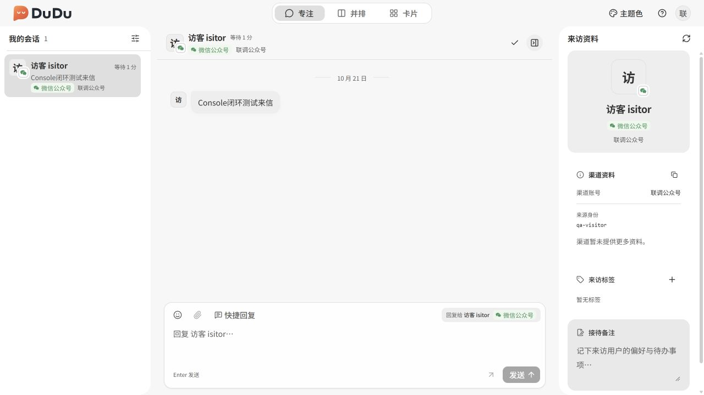
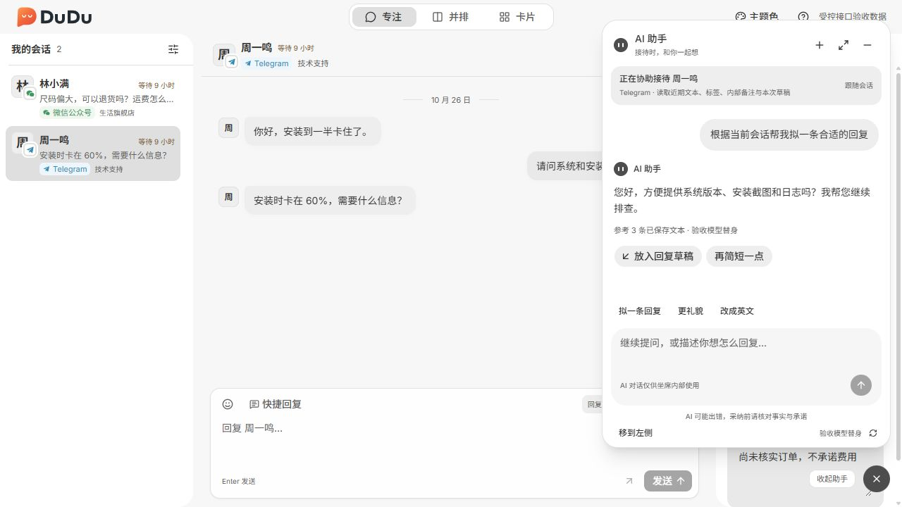
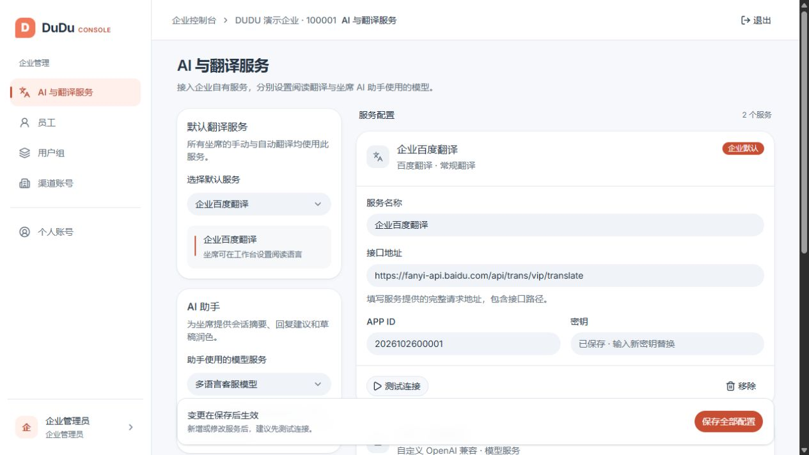
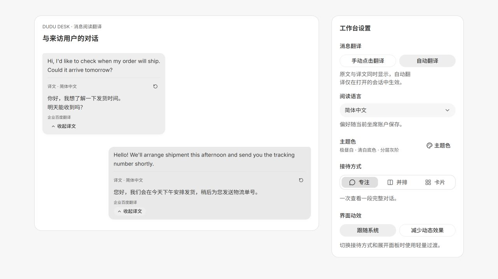
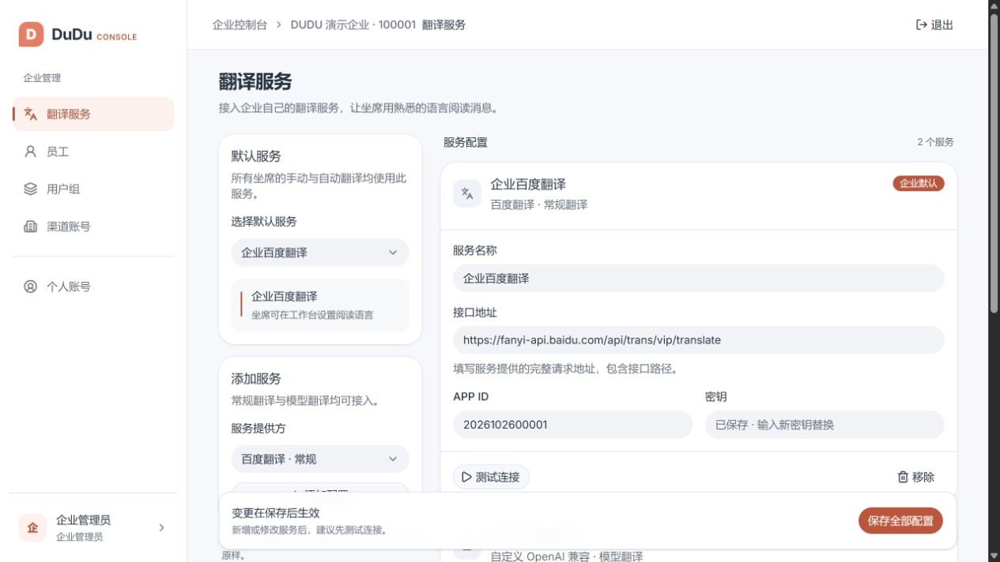

# DuDu | Open-source multichannel customer support

[简体中文](README.md) | **English**

[](LICENSE)

**Bring messages from multiple channels into one agent workspace, hosted on your own infrastructure.**

DuDu helps support teams receive channel messages, review conversation history, send replies and maintain visitor profiles in one place. It integrates specific messaging interfaces from WeChat, Telegram, WhatsApp and other platforms, with access scoped by organization and user group.

[**Explore the interactive tour**](https://buktal.github.io/dudu/demo.en.html) · [Project website](https://buktal.github.io/dudu/en.html) · [Setup and integration guides](https://buktal.github.io/dudu/guides/index.en.html)



*Workspace preview with sample data. The application interface is currently in Chinese.*

## Start here

| Your goal | Where to begin |
| --- | --- |
| Evaluate the product | [Interactive workspace tour](https://buktal.github.io/dudu/demo.en.html): select a channel, open a conversation, send a sample reply and view visitor details |
| Deploy and use DuDu | [Run locally](#run-locally), then follow the [setup and channel guides](https://buktal.github.io/dudu/guides/index.en.html) |
| Understand the code or contribute | [Repository layout](#repository-layout), [development and contributions](#development-and-contributions), and [technical documentation](docs/README.md) |

The tour uses fixed sample data and does not connect to a server or real channels. It is a simplified introduction, not a live trial. DuDu is under active development and currently requires building from source and self-hosting; there are no official release packages.

## How teams use DuDu

1. **Configure the team and channels.** A platform administrator provisions an organization. An organization administrator then configures staff, user groups and channel accounts.
2. **Receive and reply to messages.** Agents sign in to the workspace and handle conversations within their authorized scope, reviewing history and sending plain-text replies.
3. **Preserve context.** Authorized staff share visitor tags and internal notes so future conversations retain the relevant information.

The workspace offers focused, side-by-side and card layouts with shared data and drafts. It runs in a browser and supports Tauri desktop builds. **MockPulse is an optional development tool; it is not required to run the support system.**

Explore each application: [Desk](https://buktal.github.io/dudu/products/desk.en.html) · [Console](https://buktal.github.io/dudu/products/console.en.html) · [Admin](https://buktal.github.io/dudu/products/admin.en.html) · [MockPulse](https://buktal.github.io/dudu/products/mockpulse.en.html) · [Server](https://buktal.github.io/dudu/products/server.en.html).

## Is DuDu a fit?

DuDu is intended for teams that need several official messaging integrations, can manage their own deployment and want control over organization data. Technical setup and ongoing maintenance are required.

- **Current capabilities:** unified conversations, search and filters, history, real-time incoming messages, plain-text replies, message translation, an AI assistant for summaries and reply drafts, visitor tags and internal notes, staff and channel management, and organization and group access boundaries.
- **Current limits:** attachment sending is unavailable. Incoming non-text display and media retrieval depend on the channel. There is no built-in OAuth authorization wizard, automatic connectivity check or channel health monitoring.
- **Production preparation:** deployers must obtain channel accounts, platform approval and credentials, then validate real message receipt and delivery. Complete configuration does not establish valid authorization or working production messaging.

Implementation status and verification scope are recorded in the [feature maps](docs/features/README.md).

## Floating AI assistant

Open the assistant alongside a conversation to summarize the request, draft a reply, polish your writing or ask follow-up questions. It follows the current visitor across focused, side-by-side and card layouts. Adopt a suggestion into the reply draft, review it and send through the usual composer



The initial organization administrator selects a supported model in Console's **AI and translation services**, independently of the translation default. Recent authorized messages, tags, internal notes and the current draft are sent to that model. The assistant remains disabled until configured



*Screenshots show real components with fixed sample data and model responses. Actual use requires your own model service. The application UI is currently in Chinese*

## Message translation

Agents can translate individual text messages or enable automatic translation and choose their reading language in workspace settings. Original text and translations appear together; messages sent to visitors remain unchanged

**Desk: read translations and set your reading preferences**



**Console: connect your organization's translation services**

The initial organization administrator can configure conventional translation APIs or model-based services, test a connection and select the organization default. Saved credentials are not returned. Agents share that service while keeping individual reading preferences



*Screenshots show real components with fixed sample data and do not call providers. Actual translation requires your own service configuration and connection testing. Available services and environment requirements are listed in Console. The application UI is currently in Chinese*

## Channels and limitations

DuDu currently implements **13 channel integrations**. Each supports the specific interface below; this does not imply support for every product or messaging capability offered by the platform.

<details>
<summary>View channel interfaces and limitations</summary>

| Channel | Supported interface / main boundary |
| --- | --- |
| WeChat Official Accounts | Plaintext callbacks; Official Account AES mode is not supported |
| WeChat Mini Programs | Customer service callbacks, including plaintext and encrypted modes |
| WeCom | Custom application agent callbacks; aibot is not supported |
| DingTalk | Encrypted HTTP callbacks; Stream is not supported |
| Feishu | HTTP Webhook, with optional encryption configuration |
| QQ | Bot Webhook; sending in guild/channel conversations is restricted |
| Weibo | Fan service messages; sending requires an existing authorized token |
| Douyin | Implemented direct messaging interface; sending requires existing authorization credentials |
| Xiaohongshu | Mini program customer service messaging |
| Alipay | Life Account messaging |
| Meituan | Partner platform push; HTTP on port 80/8080 only, preserving the actual public Host |
| Telegram | Bot API Webhook; token rotation must retain the same Bot ID |
| WhatsApp | Cloud API Webhook; sending is subject to platform permissions and conversation rules |

</details>

See the [channel configuration reference](docs/design/dudu-console/channel-fields.md) for fields and prerequisites. The [channel research](docs/research/channels/README.md) covers more platforms than the implemented integrations; research alone does not mean an integration is available.

## Repository layout

| Project | Audience / responsibility | Technology |
| --- | --- | --- |
| [DuduDesk](dudu-desk/README.md) | Agents: conversations, replies, and visitor profiles | React, TypeScript, Tauri 2 |
| [DuduConsole](dudu-console/README.md) | Organization administrators: staff, groups, and channel accounts | React, TypeScript |
| [DuduAdmin](dudu-admin/README.md) | Platform administrators: organization provisioning, overview, and operation logs | React, TypeScript |
| [DUDU Server](dudu-server/README.md) | Authentication, authorization, persistence, channel adapters, HTTP/WebSocket | Java 21, Spring Boot 3.5, MyBatis-Plus, MySQL |
| [MockPulse](mock-pulse/README.md) | Developers: local callback simulation and protocol testing | React, Tauri 2, Rust |
| [Website](website/README.md) | Visitors: GitHub Pages project website with the project overview, product tours, and guides | HTML, CSS, JavaScript |

Each frontend manages its dependencies independently using Yarn 4, Vite, Tailwind CSS, and shadcn. MockPulse is optional: run it when you need to simulate platform callbacks, not as a prerequisite for running the support system.

## Run locally

This is a development walkthrough. The administration apps and agent workspace run in a browser without Rust. Ports below are explicitly selected for this walkthrough.

### 1. Prerequisites

- Git, Java 21, Maven 3.9, and Docker Compose.
- Node.js 22.12+. Enable Corepack and use the Yarn 4 version declared in each project's `packageManager` field.
- For desktop builds, install Rust and the operating system dependencies listed in the [Tauri 2 prerequisites](https://v2.tauri.app/start/prerequisites/).

```sh
git clone https://github.com/Buktal/dudu.git
cd dudu
corepack enable
```

### 2. Start MySQL and Server

From the repository root, start development MySQL and then Server in the same terminal:

```sh
docker compose -f dudu-server/compose.yaml up -d --wait
cd dudu-server
mvn spring-boot:run
```

Server listens on `8080`; Flyway applies database migrations automatically. The first start against an empty database creates the platform administrator **`admin` / `admin`**. The Compose database passwords and default Server JWT secret are for local development only and must be changed before exposing the service. See the [Server deployment instructions](dudu-server/README.md#线上部署边界).

### 3. Provision an organization and sign in

Open three additional terminals, each starting from the repository root:

```sh
# Terminal A: platform administration
cd dudu-admin
yarn install
yarn dev --port 5173 --strictPort
```

```sh
# Terminal B: organization console
cd dudu-console
yarn install
yarn dev --port 5174 --strictPort
```

```sh
# Terminal C: agent workspace
cd dudu-desk
yarn install
yarn dev
```

1. Open [Admin](http://localhost:5173), sign in with the local platform administrator, and create an organization with its initial administrator. Note its six-digit organization ID.
2. Open [Console](http://localhost:5174) and sign in using that ID and the initial administrator. Create staff accounts and groups, add group members, and connect a channel account.
3. Open [Desk](http://localhost:1423) and sign in with the organization ID and a staff account assigned to a group. An empty inbox is expected when no channel account is in the staff member's scope.
4. Configure the callback URL shown in Console on the channel platform, or use [MockPulse](mock-pulse/README.md) for local protocol tests. Desk shows conversations after receiving valid messages. Replies also require the channel's sending credentials and platform permissions.

All three frontend development servers proxy `/api` to the local Server; Desk also proxies `/ws`. Consult each project's README for production API origins, WebSocket routing, and public callback origin configuration. These commands are not a production deployment procedure.

## Development and contributions

Use [Issues](https://github.com/Buktal/dudu/issues) for bugs and proposals. Include the affected project, version or commit, reproduction steps, expected and actual behavior, and sanitized error details. Do not upload channel secrets, tokens, or real visitor data.

Before changing behavior, review the relevant [contracts and designs](docs/design/README.md) and [engineering conventions](AGENTS.md). Preserve authorization boundaries and update the corresponding feature map when changing a feature. In each affected frontend project, run:

```sh
yarn lint
yarn check:type
yarn test
yarn build
```

Run `mvn test` in `dudu-server/`. Database integration tests are skipped by default; enable them explicitly and use an isolated review database as described in the [Server testing instructions](dudu-server/README.md#数据库集成测试). Never point integration tests at development or production business databases. For desktop Rust changes, also run that project's `yarn check:rust`.

Further reading: [feature maps](docs/features/README.md) · [architecture decisions](docs/adr/) · [domain glossary](GLOSSARY.md) · [channel protocol research](docs/research/channels/README.md). Most detailed project documentation is currently in Chinese.

## Open-source license

DuDu is licensed under the [Apache License 2.0](LICENSE). It permits use, modification, distribution, and commercial use, including proprietary modified products, subject to its terms. Distributions must retain applicable copyright and license notices and identify modifications as required. The license does not grant trademark rights and provides no warranty.

Third-party dependencies and assets remain subject to their respective licenses; this project's license does not replace those terms.
