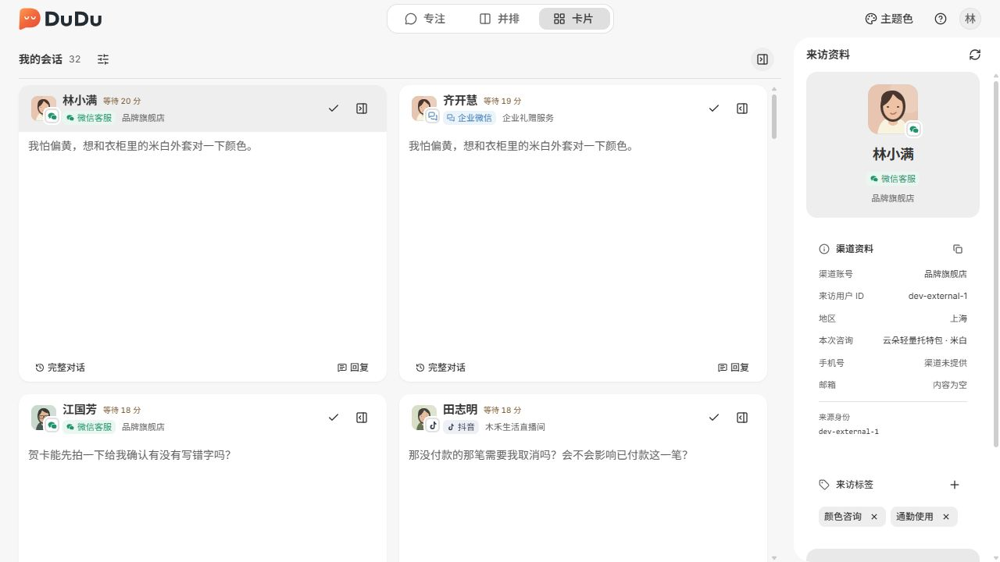
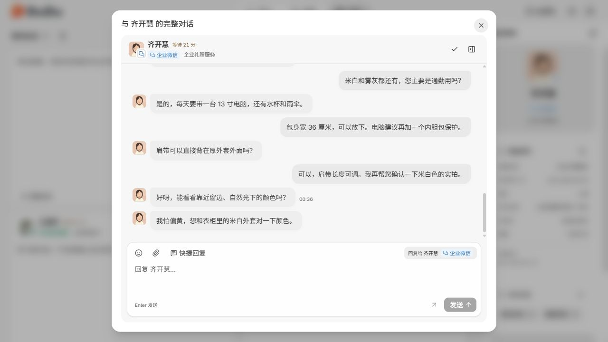

# 卡片最后消息摘要与星标移除验收

日期：2026-10-10。路径以仓库根为准；业务决定见 [对接设计](../data-contract.md)。本页是当前前端变更的验收记录，不是后端契约。

- 星标：删除三个模式、查询工具和资料面板的入口，以及 API、store、Mock 与类型中的对应状态。并排固定会话保留。
- 卡片：只使用 `Conversation.preview` 显示最后消息摘要，不再为每个挂载卡片查询历史或展示多条气泡；回复、草稿、资料开关和完整对话入口保留。
- 完整对话继续复用原有消息分页及虚拟滚动。共用工作区初始化仍自动选择首位访客并读取其消息，本轮未改此启动行为。
- 浏览器验收：自建 Vite 端口 1433、显式 Mock、1280×720；未启动或关闭用户通过 IDEA 启动的应用，未打包桌面版。
- 检查：类型检查、lint 通过；`yarn test --maxWorkers=2`：41 文件、281 测试通过。新增测试核对摘要变化不触发历史请求、打开完整对话才请求，以及草稿收起后恢复。
- 首次默认并发测试出现 Mock 加载超时；降低并发后整套通过。另一个测试断言已限定消息区域，避免把标题等待时间误判为历史消息时间。
- 开发浏览器日志仍出现 `ResizeObserver loop completed with undelivered notifications`；本轮没有修改消息虚拟滚动参数，也未将这次界面核验视为桌面滚动问题的回归验收。临时 Vite 与验证标签页已关闭。

## 实际界面

卡片只显示一条摘要，标题和资料面板无星标：

点击完整对话后仍可查看多条历史并回复：

## 复现

在 `dudu-desk` 子项目按 README 启用 `VITE_DESK_MOCK=true` 并启动开发界面；切换卡片模式，核对每张卡片的最后消息摘要。点击回复、输入草稿、点击卡片外再回来，草稿应保留；点击完整对话应展示历史，关闭后回到原卡片。切换并排模式验证固定会话仍可操作。

名片跨端通知、统一待处理提醒以及三表后端尚在设计，本页不宣称这些功能已实现。
