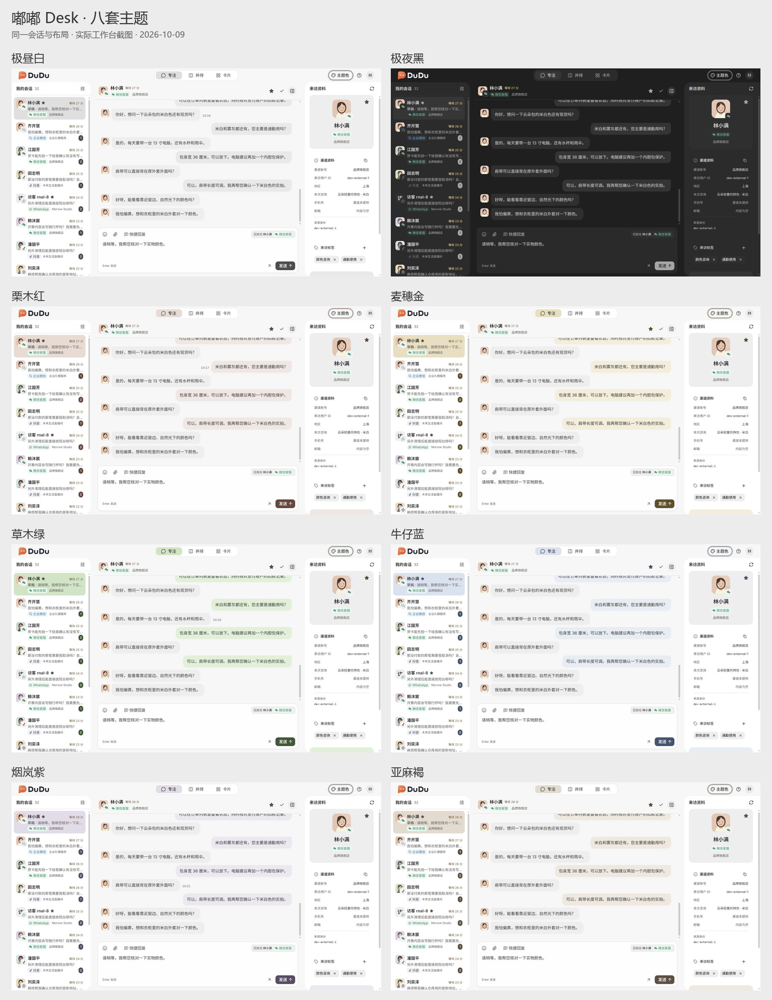

# DuduDesk 八套主题配色

2026-10-09。正式工作台配色调整记录，依据用户提供的微信、飞书深浅色截图，以及此前的选色反馈。截图均来自 `dudu-desk` 正式组件与现有开发适配器；该适配器已于 2026-10-13 移除，「复现」一节的 `VITE_DESK_MOCK` 步骤仅存档。

## 方向与结果

用户确认保留极昼白、极夜黑，浅色主题共用文字与辅助灰阶；不要选中会话的深色侧边条，不喜欢偏青、偏亮的绿色。极夜黑明确选择灰色客服气泡。后续授权综合微信、飞书的优点调整全部主题，包括名称与颜色基调。

实施采用中性底色、轻微明暗分层、少量柔和强调色。七套浅色主题共用正文、辅助文字、面板、访客气泡、输入控件与分隔线；客服气泡、选中背景和按钮／标记分别使用同色系的浅、中、深三档。极夜黑采用中性炭灰，正文和辅助信息分层，客服与访客气泡均为灰色。所有消息气泡不显示描边，选中会话只用整块背景填色。

名称“栗木红”“草木绿”与具体色值是本次实施选择。栗木红比初选枣木红更偏暖红棕，浅底减少粉感；草木绿取微信浅色气泡的草绿方向并收低饱和度。金、蓝、紫、褐同步校准，与公共灰阶保持一致。

| 主题 | 颜色方向 | 完整截图 |
| --- | --- | --- |
| 极昼白 | 中性白与分层浅灰 | [专注](daylight-calm.jpg)、[卡片](daylight-quick.jpg) |
| 极夜黑 | 中性炭灰与灰色气泡 | [专注](midnight-calm.jpg)、[并排](midnight-parallel.jpg)、[卡片](midnight-quick.jpg) |
| 栗木红 | 暖红棕强调与柔和暖灰浅底 | [专注](crimson-calm.jpg) |
| 麦穗金 | 一致的米金色阶 | [专注](amber-calm.jpg) |
| 草木绿 | 不偏青的清浅草绿 | [专注](citrus-calm.jpg)、[并排](citrus-parallel.jpg) |
| 牛仔蓝 | 降低饱和度的灰调蓝 | [专注](ocean-calm.jpg) |
| 烟岚紫 | 克制的灰调紫 | [专注](iris-calm.jpg) |
| 亚麻褐 | 接近中性的浅米褐 | [专注](oat-calm.jpg) |



## 实现边界

颜色数值仍以 [dudu-desk/src/index.css](../../../../dudu-desk/src/index.css) 为唯一来源；主题名称、顺序与旧标识恢复由 [theme-palette.ts](../../../../dudu-desk/src/lib/theme-palette.ts) 管理。保留原稳定标识，退休主题按相近色系恢复，兼容已有模式与减少动态效果偏好。

消息组合复用现有 Bubble 的 `secondary` 变体，客服气泡局部绑定 `accent` 及配对前景色；没有修改 shadcn 生成组件或新增依赖。浅色按钮由主题基色混入 18% 黑色，保留现有 80% 悬停行为的文字对比度。状态色、渠道标识与品牌继续按各自语义维护。

当前行为与偏好迁移规则见 [DuduDesk README](../../../../dudu-desk/README.md)。[原型色系卡](../../../prototype/dudu-desk/palette-study/README.md) 保留最初选色历史，颜色与名称不再代表正式版。

## 验证结果

- `yarn lint`：193 个文件通过。
- `yarn build`：两套 TypeScript 配置检查与 Vite 生产构建通过。构建仍提示主 JS 分块超过 500 kB，本次没有扩展做拆包。
- `yarn test --reporter=dot`：39 个测试文件、271 项测试通过，包含八套偏好恢复与退休主题迁移。
- [对比度检查](contrast-report.json)：七套浅色共享灰阶一致；核心正文、辅助文字、主要链接和主按钮正常／悬停标签最低为 **4.585:1**。此检查不包含禁用控件、渠道徽标与状态色，也不等同于长期观看舒适度测量。
- 默认 1280 × 720 浏览器窗口逐套检查八种主题，均无页面横向溢出。正文、访客气泡和边框计算值见 [界面读数](ui-colors.json)。
- 专注、并排、卡片均实看；主题与模式切换后可以继续编辑同一份未发送草稿。方向键移动主题焦点、空格应用、Esc 关闭并返回触发按钮正常。完整刷新后恢复草木绿与专注偏好，见 [交互记录](ui-interactions.json)。
- 390 px 和 360 px 宽度下双列菜单可用；320 px 下转为单列，八个选项完整可见。320 px 的聊天、气泡和回复区无横向溢出。截图：[390 px 菜单](theme-menu-390.jpg)、[360 px 菜单](theme-menu-360.jpg)、[320 px 菜单](theme-menu-320.jpg)、[320 px 聊天](citrus-calm-320.jpg)。临时尺寸覆盖已恢复。

本轮验证为浏览器与开发数据；未重新验证 Tauri 原生窗口或真实渠道收发。编辑阶段开发服务曾记录 Context 热更新失效与 ResizeObserver 通知，完整刷新后界面恢复，最终浏览器捕获的控制台日志没有警告或错误；没有扩大修改热更新或滚动实现。

## 复现

在 `dudu-desk` 子项目根运行：

```powershell
$env:VITE_DESK_MOCK = 'true'
$env:VITE_DESK_SCENARIO = 'default'
yarn web:dev --host 127.0.0.1 --port 1425 --strictPort
```

打开终端给出的地址，在主题菜单切换配色。示例使用现有固定种子的开发数据；图片中的草稿只是输入验证，没有发送。

从仓库根核对当前正式颜色：

```powershell
node docs/design/dudu-desk/palette-refresh/inspect-palettes.mjs
```

[inspect-palettes.mjs](inspect-palettes.mjs) 直接读取正式 CSS 与主题登记，不维护第二份色值。它会更新同目录的对比度报告。已有完整截图可用 [assemble-previews.py](assemble-previews.py) 重新拼成对照图，脚本使用本机已有 Pillow 与微软雅黑字体，只缩放和排列截图。
