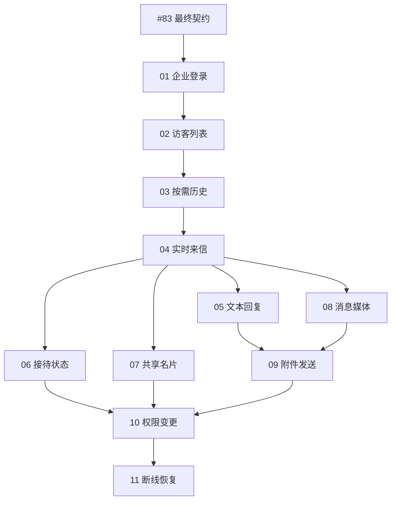

# DuduDesk 对接实施票索引

日期：2026-10-10。状态：**已按用户本轮发布要求创建 11 张实施 Issue（#85–#95），均为 #84 子票，原生依赖已核验**。

来源：[已发布 Spec #84](https://github.com/Buktal/dudu/issues/84) 与[本地 Spec 正文](integration-spec.md)。本文件是实施拆分与发布索引，不代替[数据契约讨论](data-contract.md)，不新增字段或协议决定。文内相对链接均相对此文件解析；01–11 是拆分顺序，GitHub Issue 编号为 #85–#95。每份本地正文保留为发布时的镜像，后续执行状态与原生依赖以 GitHub 为准。

## 发布与开工边界

- 用户在查看拆分后明确要求发布到 Issue；现已逐张创建为 #84 的子 Issue，应用 ready-for-agent 标签，并设置 GitHub 原生阻塞关系。父 Spec 的正文和状态保持不变。
- 01 直接受[最终契约 #83](https://github.com/Buktal/dudu/issues/83)阻塞，其余票经依赖链继承；不将实施票设置为等待父 Spec #84 关闭，避免形成完成条件上的循环。
- #83 仍依赖消息规则 #80、媒体边界 #81、查询与恢复 #82。三表方向已确认，但具体字段、成功确认、失败保留、并发顺序、媒体策略及 HTTP/Socket 报文仍未定稿。发布实施票不会消除这些阻塞。
- 每张票开工时读取 #83 的最终决议及当前契约；若与票内行为验收冲突，先补齐受影响草稿/票据再实施，不能自行猜字段。未关闭阻塞前不按 ready-for-agent 标签宣称可以直接无人值守开发。
- 当前没有可开工的实施票；先完成 #80/#81/#82，再完成 #83。契约门槛通过后从 01 开始，04 完成后 05/06/07/08 可分别推进。
- 只拆本轮对接：星标删除和卡片摘要简化已经完成，后续保留回归验收，不重复开发。没有另立建表、Controller、Socket 框架或集中补测试的横向票；既有 AccountApi/InboxApi 和共享状态边界足够，不预排大重构。

## 编号拆分

1. **DuduDesk：企业登录与接待范围初始化** — [#85](https://github.com/Buktal/dudu/issues/85) · [发布正文](ticket-01-login.md)
   - 阻塞：#83。
   - 交付：真实企业登录、恢复员工身份、多组接待范围、空组空态，以及退出/切换员工清理。
2. **DuduDesk：持久访客列表、筛选与摘要查询** — [#86](https://github.com/Buktal/dudu/issues/86) · [发布正文](ticket-02-visitor-queue.md)
   - 阻塞：01。
   - 交付：持久访客及消息摘要可查询，列表和卡片共用摘要，完整授权范围内搜索、排序、计数与列表分页。
3. **DuduDesk：按需对话历史与三种接待模式** — [#87](https://github.com/Buktal/dudu/issues/87) · [发布正文](ticket-03-history.md)
   - 阻塞：02。
   - 交付：完整对话先加载最近页，向上滚动再补旧页；共享缓存与草稿，保持并排固定和原虚拟滚动。
4. **DuduDesk：实时来信与登录订阅衔接** — [#88](https://github.com/Buktal/dudu/issues/88) · [发布正文](ticket-04-live-incoming.md)
   - 阻塞：03。
   - 交付：文本入站持久化、消息去重、共享待回复、真实 Socket 与初始化衔接；未打开访客也实时更新。
5. **DuduDesk：文本回复、发送结果与共享提醒** — [#89](https://github.com/Buktal/dudu/issues/89) · [发布正文](ticket-05-text-reply.md)
   - 阻塞：04。
   - 交付：目标绑定、真实发送、幂等/超时核实、发送员工记录，以及多设备状态和已处理提醒同步。
6. **DuduDesk：结束、继续与再次来信接待** — [#90](https://github.com/Buktal/dudu/issues/90) · [发布正文](ticket-06-reception-state.md)
   - 阻塞：04。
   - 交付：跨设备结束/继续，已结束访客再次来信恢复待回复，保留固定会话与历史。
7. **DuduDesk：共享名片编辑与覆盖确认** — [#91](https://github.com/Buktal/dudu/issues/91) · [发布正文](ticket-07-visitor-profile.md)
   - 阻塞：04。
   - 交付：名片读取、标签备注保存、其他设备刷新，编辑保护、覆盖确认及取消后最新快照。
8. **DuduDesk：多类型消息与媒体查看** — [#92](https://github.com/Buktal/dudu/issues/92) · [发布正文](ticket-08-message-content.md)
   - 阻塞：04。
   - 交付：按约定渠道事实展示图片、文件、音视频、链接、位置、引用、卡片等内容，并处理媒体权限、期限和失效。
9. **DuduDesk：附件准备与发送能力同步** — [#93](https://github.com/Buktal/dudu/issues/93) · [发布正文](ticket-09-send-attachments.md)
   - 阻塞：05、08。
   - 交付：附件准备、草稿、取消清理、能力限制/变更、真实发送结果与另一设备/重登后的展示。
10. **DuduDesk：权限变更与工作区清理** — [#94](https://github.com/Buktal/dudu/issues/94) · [发布正文](ticket-10-access-changes.md)
    - 阻塞：06、07、09。
    - 交付：账号换组、员工退组/增权后及时调整读写和推送范围，清理无权缓存与迟到结果，历史只有一份。
11. **DuduDesk：断线对账与跨资源恢复** — [#95](https://github.com/Buktal/dudu/issues/95) · [发布正文](ticket-11-recovery.md)
    - 阻塞：10。
    - 交付：断线、重启和漏推后补齐消息、结果、名片、状态及权限/能力；修复历史缺口，保留合法草稿且不重建已处理提醒。

## 依赖理由

| 依赖 | 必要性 |
| --- | --- |
| #83 → 01 | 真实企业认证及后续通信使用最终契约，不能边实现边猜报文。 |
| 01 → 02 | 持久访客查询需要真实员工与企业/组接待范围。 |
| 02 → 03 | 历史操作复用已有固定访客、message 与访客选择入口。 |
| 03 → 04 | 实时来信需同时验证未打开摘要与已打开历史，包含查询/推送竞态。 |
| 04 → 05/06/07/08 | 分别复用真实鉴权 Socket、资源更新与入站路径，完成各自的在线行为闭环。 |
| 05、08 → 09 | 附件发送复用逻辑发送/结果处理和媒体引用/显示，而非复制两套规则。 |
| 06、07、09 → 10 | 动态收权必须对已存在的状态操作、名片编辑及文本/附件准备发送执行完整在途验收；05、08 已被 09 传递覆盖。 |
| 10 → 11 | 最终恢复需要全部资源及当前权限清理已接入，才能验证断线期间资料、发送结果和授权同时变化。 |

## Spec 覆盖核对

用户故事编号对应 Spec 的 User Stories；验收编号对应 Testing Decisions 下的“必须覆盖的验收场景”。同一场景可以分阶段验证，后续票不能以未来综合核验代替本票验收。

| 票 | 用户故事 | 验收场景 |
| --- | --- | --- |
| 01 | 1–5、30–31、45 | 1、14、17 |
| 02 | 3、6–9、11、17–18、47 | 1–3、6、16–17 |
| 03 | 9、11–16、19–20 | 3–4、17–18 |
| 04 | 6–8、10、14–16、17–18、31 | 2、4–6、8、14、17 |
| 05 | 19、21–27、30、40 | 7–10、17 |
| 06 | 6、26、28–29 | 2、9–10、17 |
| 07 | 17、32–39、47 | 6、11–12、16–17 |
| 08 | 11、41、47 | 3、15、17–18 |
| 09 | 19、21–25、40、47 | 7–8、15、17 |
| 10 | 3–5、8、44–46 | 1、14、17 |
| 11 | 14–16、30–31、36–39、42–45、47 | 4、8–9、11–18 |

故事 48 是全部 11 票的交付义务：更新契约实施状态、功能记录和必要的领域决定，保留未完成或未验证范围。最终表结构仍只有已确认的三张核心表；02 负责 visitor/message 读取所需迁移，07 随完整名片功能落地 visitor_profile，后续实际结构变化另增迁移。

## 各票必须遵守的验证边界

- 真正读取/写入数据和发布通知的行为，使用真实 Server HTTP/Socket 与独立 MySQL 验收；数据库测试不能被无数据源的 MockMvc 测试替代。
- 各票就近测试自己的竞态：03 历史合并，04 初始化与重复入站，05 逻辑发送与旧结果，06 状态竞争，07 编辑覆盖，09 附件准备，10 动态权限，11 跨资源恢复。
- 多设备同步使用两个真实 Desk 客户端，包含不同员工及同一员工的不同设备。渠道侧可受控替代，但不 Mock 待验收的 Server 与客户端通信，不承诺全部渠道生产投递已验收。
- 交互变更核验实际界面；03 和 08 提前核验打包桌面分页/媒体滚动，11 核验最终接入后的综合体验。原消息虚拟滚动写法保留。
- 结构变化执行空库迁移、已有版本升级和重启保留；只新增 Flyway 迁移、无外键。每张票完成所影响项目的类型检查/lint/编译与必要测试。

## 本轮发布与核验

- 发布前确认 #84 远端正文与本地 Spec 一致，无评论及实施子票；发布后核验新增的 11 张子票恰为 #85–#95，父票正文摘要、标题、状态、标签及评论保持不变，原生阻塞仍为开放的 #83。
- 本轮发布实施 Issue 并同步本地正文与索引，不修改业务代码、不执行迁移、不运行与文档变更无关的应用测试。
- 已通过文档检查：11 份独立正文、91 项验收检查、48/48 用户故事与 18/18 Spec 验收场景覆盖、23 个本地链接有效；依赖无环、无冗余直接边，全部传递受 #83 阻塞；正文模板与无具体源码路径检查通过，新增文档及 Git 差异空白检查通过。
- 全部 11 张 Issue 的标题和正文与本地发布内容一致，状态均为 open，均含 ready-for-agent 标签，父子关系与原生阻塞逐项核验通过。正式正文不重复维护文本阻塞清单；原生依赖依次为 #85←#83、#86←#85、#87←#86、#88←#87、#89/#90/#91/#92←#88、#93←#89/#92、#94←#90/#91/#93、#95←#94（箭头右侧阻塞左侧）。
