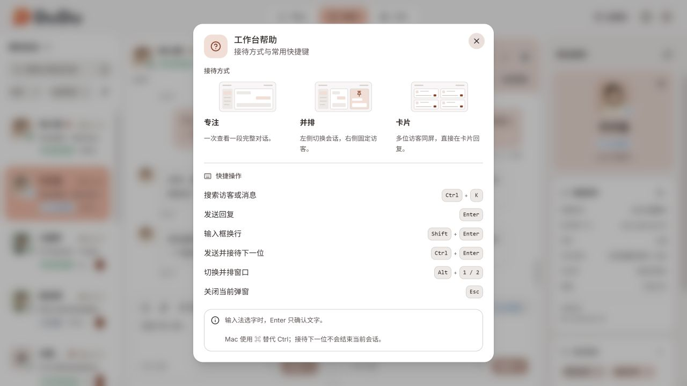
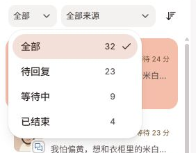

# DuduDesk 工作台交互调整

2026-09-18。对应本轮 11 项界面与交互反馈，沿用已确认的 Logo、珊瑚橙品牌色和十二款主题

设计重点是减少常驻控件、让操作贴近所作用的会话，并维持浅背景与重点操作的层次。帮助弹窗用三幅真实布局缩略图增加识别性，其余区域保持克制

## 调整对照

| 反馈 | 实现 |
| --- | --- |
| 1. 会话筛选混乱、占高 | 搜索单独一行；状态和来源下拉框并排，排序收为图标菜单。四种状态及计数放进状态菜单，224 px 队列可容纳。 |
| 2. 无意义提示、渠道复制 | 移除“星标已保存”“资料已读取”；渠道资料标题旁增加复制按钮，一次复制渠道、账号、字段和来源身份，保留缺失与空值的区别。 |
| 3. 图标与悬停区域不居中 | 修正表情、紧凑快捷回复、发送并接待下一位按钮的图标布局。 |
| 4. 快捷回复上方留白 | 收紧弹层内边距、标题与选项间距；选中后插入草稿并返回输入框。 |
| 5. 顶部多余标题 | 去掉可见的“接待方式”，保留无障碍分组名称。 |
| 6. 左侧队列展开／收起 | 桌面专注和并排固定显示队列，卡片模式不显示；窄窗保留返回列表操作。 |
| 7. 固定会话操作位置 | 移除全局固定窗工具栏，将固定、取消固定和更换操作放在对应会话标题中；修复取消唯一固定会话时丢失主窗的问题。 |
| 8. 卡片头像、搜索、滚动 | 统一头像尺寸；宽窗搜索框外层限制为 256 px；移除卡片内的滚动链阻断。 |
| 9. 主题菜单冗余内容 | 移除自动保存说明和“完成”，保留点击即时应用。 |
| 10. 帮助弹窗过于朴素 | 增加三种模式的小布局图、主题色图标和清晰的快捷键分区；窄窗使用纵向图文布局。 |
| 11. 标题颜色、消息置底 | 当前卡片／并排会话标题与资料卡共用较浅的 `sidebar-accent`；稳定虚拟列表组件身份和底部间距，收紧置底判定并增加预渲染。 |

## 桌面预览

### 专注


### 并排


### 卡片


### 帮助



其他截图：[极夜黑并排](parallel-midnight.png)、[窄桌面并排](parallel-1024.png)、[快捷回复](quick-replies.png)、[主题菜单](themes.png)

## 窄窗预览

[专注](mobile-focus.png) · [并排](mobile-parallel.png) · [卡片](mobile-cards.png) · [状态筛选](mobile-filters.png) · [帮助](mobile-help.png) · [主题](mobile-themes.png)

## 验收

通过显式启用的开发适配器，在 Chromium 浏览器中检查实际工作台，未发送测试消息；插入验证用草稿后已清空

- `yarn lint`：184 个文件通过
- `yarn test`：34 个测试文件、231 项测试通过。新增渠道资料复制内容和取消唯一固定会话的逻辑回归测试
- `yarn build`：类型检查和生产构建通过；保留既有主包超过 500 kB 的提示
- 工作台检查宽度：1280、1024、390 px；移动视口为 390 × 844。无文档横向溢出
- 卡片滚动：同一卡片内部位置使用滚轮，修复前列表停在 0，修复后 `scrollTop` 从 0 增加到 720
- 快捷回复：插入后弹层关闭、焦点返回当前会话输入框；通过实际键盘操作清空草稿
- 消息置底：专注模式加载较早历史后点击最新消息，距底部 2 px；1024 px 并排右窗点击后距底部 1 px，左窗位置保持 2714 px
- 主题与帮助弹窗在窄窗中可完整阅读；主题即时应用，无冗余底部操作
- 图标中心与按钮中心的水平、垂直差值均为 0 px；卡片头像为 41 × 41 px，与会话标题一致
- 极夜黑下，当前会话标题与资料卡的计算背景色一致

以上消息置底与布局结果属于浏览器验收。后续补充的原生卡片滚动排查与验证见下文

既有队列来源去重与固定会话选择器分页去重可分别复用 `lodash-es` 的 `uniqBy`、`uniq`，本轮保持原实现

实现入口见 [DuduDesk 功能图谱](../../../features/dudu-desk.md)

## 状态下拉菜单补验

用户补充的展开态截图暴露了数字裁切：菜单默认宽度 144 px，内部固定最小宽度挤占了勾选标记的位置。状态菜单现改为 192 px 并与按钮左侧对齐，内容区可收缩，数量靠右且保留勾选间距

修复后四行数量均未越界，数字与勾选之间保留 8 px；在 1280 px 专注、1024 px 并排及 390 px 卡片视口下复验通过。切换状态、键盘展开、`yarn lint` 和 `yarn check:type` 通过。本次仅调整布局，使用真实浏览器边界测量验收，未新增展示层测试

[修复前用户截图](status-menu-before.png) · [修复后完整截图](status-menu-after.png)



## 卡片滚动与固定入口补验

### 原生端持续抖动

用户在 Tauri 开发窗口中配合滚动后，采样发现停手时位置仍在 `110 ↔ 507`、`303 ↔ 700` 之间反复切换。每次相差 397 px，恰好是一张 380 px 卡片加 17 px 行间距；对应的虚拟列表上方占位也在 0 和 397 px 之间切换，卡片尺寸及总高度保持稳定

原因是 WebView2 的默认滚动锚定与 VirtuosoGrid 的虚拟占位调整互相补偿。卡片列表滚动容器现显式使用 `overflow-anchor: none`，并保留滚动条空间。回复对象未改变时不重复调用 `scrollToIndex`；在卡片内点击、输入时保留当前卡片的位置

| 桌面操作采样 | 修复前 | 关闭滚动锚定后 |
| --- | ---: | ---: |
| 采样记录 | 329 | 1312 |
| 停手后的可比较位置 | 94 | 41 |
| 其中不在列表顶部 | 94 | 17 |
| 无输入时的意外位置变化 | 81 | 0 |

用户已确认停止持续抖动，并再次确认滚到列表中间、停手 5 秒后保持稳定

### 减少滚动时的同步工作

用户随后反馈“稳定但不够顺滑”，并说明 Chrome 没有相同体感。原生 WebView2 153.0.4234.32 的长帧记录将约 33–54 ms 的主要脚本耗时归因到 Virtuoso 的 `DIV.onscroll` 同步更新，强制布局耗时只占小部分。这里有前端更新的直接证据，不能据此断定 Rust 主进程或 GPU 存在问题

后续改动沿用现有 React、React Redux 和 react-virtuoso

- `QuickCard` 使用 `memo`，历史与资料操作使用稳定回调；资料回调接收明确的展开状态，切换回复对象不会更换所有卡片的回调
- 消息选择结果使用 `shallowEqual`，其他会话的消息变化不会重绘当前卡片
- 总数已知且不超过 36 张时保留短队列的卡片，避免滚动时反复初始化编辑器。总数更多或未知时继续虚拟化，预渲染范围为上下各 800 px，另有 400 px 的 overscan

卡片级回放发现，常规预渲染在往返滚动时仍重新挂载 6 张卡片；保留短队列后为 0。为避免混用窗口尺寸，另做了一组固定条件的对照：1536 × 912、DPR 1，从顶部向下滚动四次、再向上四次，每次 0.42 页、间隔 180 ms，共两轮。两组均已包含 memo、稳定回调和消息隔离，仅改变短队列的保留策略

| 固定视口对照 | 常规 800 px 预渲染 | 保留短队列 |
| --- | ---: | ---: |
| 第一轮 React 渲染总耗时 | 144.4 ms | 13.4 ms |
| 第一轮最长 RAF 间隔 | 125.4 ms | 18.7 ms |
| 第二轮 React 渲染总耗时 | 62.7 ms | 14.5 ms |
| 第二轮最长 RAF 间隔 | 53.0 ms | 18.5 ms |

这些对照是浏览器中的前端回放，不是原生窗口的显示帧率。原生持续抖动已由用户与采样共同确认解决；追加的短队列保留优化尚未取得新一轮桌面人工操作采样，因此没有宣称最终原生体感已全部复验

### 交互与布局检查

- 1920 × 1032 三列布局：32 张卡片在中间位置停手 5 秒，`scrollTop` 保持 2064；返回后草稿和光标保留，完整对话读取同一草稿，测试文字已清空
- 390 × 844 单列布局：鼠标在卡片内部滚动，`scrollTop` 到达 844；文档宽度为 390，无横向溢出
- 临时扩展为 68 个未结束会话：实际渲染 14–27 张卡片，分页可达第 68 张，证明较长列表仍按需渲染。扩展数据已恢复
- 固定入口放在头像列下方，与文字区分开。在 1024 px 视口、225 px 队列内，按钮为 28 × 28 px，与头像间距 7 px；所有已渲染行均无文字重叠，图标中心偏差为 0，Tab 可聚焦固定入口
- 资料面板在不同卡片间展开、收起、切换对象均正确

[固定入口最终效果](queue-pin-final.png) · [三列滚动](cards-scroll-1920.png) · [单列滚动](cards-scroll-390.png) · [结构化检查记录](grid-ui-checks.json)

临时 RAF、React Profiler、长帧采样和 Vite 写日志插件均已移除；`vite.config.ts` 与开发数据工厂恢复原状。清理后的 `yarn lint` 通过；`yarn test` 34 个文件、231 项通过；`yarn build` 类型检查与生产构建通过

### 采样回放

原始几何与耗时记录压缩保存在 [grid-scroll.trace.ndjson.gz](grid-scroll.trace.ndjson.gz)，只有布局、输入计数与耗时，不含聊天正文。下面的命令回放已保存记录，不会驱动当前桌面窗口；jsdom 不具备复现 WebView2 滚动锚定的渲染环境，未用展示层单元测试替代实测

```powershell
# 修复前记录：FAIL，81 次无输入位置变化，退出码 1
node docs/design/dudu-desk/workspace-polish/check-grid-scroll.mjs auto
# 修复后记录：PASS，0 次无输入位置变化
node docs/design/dudu-desk/workspace-polish/check-grid-scroll.mjs none
# 按 native、stage、viewport 区分耗时采样
node docs/design/dudu-desk/workspace-polish/grid-performance-summary.mjs
```
