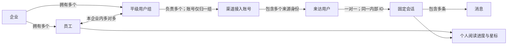

# DUDU Server 总体设计与阶段计划

更新日期：2026-09-30。状态：设计讨论记录，业务尚未实施，不能作为已经完成的接口或数据库说明。

本文件保存本轮 Server 规划的整体方向、决策索引、设计约束和待定问题，供后续会话或其他执行者接续。最新顺序为先整理 DuduAdmin 功能，提前对齐表结构与接口字段，由独立设计会话完成正式前端，再实现 Server 并联调；整体目标仍是为 Admin、Console、Desk 提供真实的多企业后端能力。Admin 不使用模拟数据。

## 文档分工与当前进度

| 资料 | 用途 |
| --- | --- |
| 本文件 | Server 整体设计入口、阶段顺序与未决事项 |
| [Admin 功能规划](../dudu-admin/README.md) | 已确认功能、范围边界和独立前端设计会话的交接 |
| [Admin 企业开通草案](../dudu-admin/company-onboarding.md) | 后续真实业务闭环与开通验收 |
| [Admin 表结构与接口字段](../dudu-admin/data-contract.md) | 前端开发前对齐的候选表、字段、ID、时间与待定约束 |
| [Admin 接口环境](../dudu-admin/api-environments.md) | 本地 IP 连接、开发切换和生产固定地址 |
| [GLOSSARY.md](../../../GLOSSARY.md) | 子项目定位与领域术语 |
| [企业隔离决策](../../adr/0011-enterprise-group-access.md) | 企业、人员、分组、账号归属与管理员权限的决定及理由 |
| [固定会话决策](../../adr/0010-persistent-visitor-conversation.md) | 会话身份、接待状态、个人阅读进度及星标的决定及理由 |
| [Server 功能图谱](../../features/dudu-server.md) | 当前实际已实现的基础能力与验证范围 |
| [Desk API 契约](../../../dudu-desk/docs/api-contract.md) | 前端已有的方法、实体、错误与事件要求 |

长期决定以相应 ADR 为准，术语以 GLOSSARY 为准，本文件只作摘要与设计衔接。当前决策由 [Admin 功能与契约地图](https://github.com/Buktal/dudu/issues/60) 跟踪；已发布 [DuduAdmin 首版前端与数据契约 Spec](https://github.com/Buktal/dudu/issues/68)，汇总前端范围、数据约束和分阶段验收。[9 张前端实施票](../dudu-admin/ticket-breakdown.md) 已经用户确认并发布，仍以数据契约及其前置业务决策完成为开工条件；后端实施和真实联调安排在前端之后。

当前 Server 已有统一返回、异常处理、JWT 认证与参数注入、校验分组和 MyBatis-Plus 基础配置；MySQL 与 Flyway 依赖已声明。真实登录、企业及员工业务、业务实体、Mapper、表结构迁移和收发接口均待实现。现有测试排除数据源自动配置，不能作为数据库集成通过的依据。

## 三个前端与一个后端

| 前端 | 使用者 | Server 对应职责 |
| --- | --- | --- |
| DuduAdmin | DUDU 运营方的平台管理员 | 企业开通、初始化企业管理员；其余运营管理能力按阶段确认 |
| DuduConsole | 企业内部管理员 | 本企业员工、用户组、渠道接入账号的管理 |
| DuduDesk | 企业坐席及需要参与接待的企业管理员 | 身份恢复、会话队列、资料、历史、发送、附件、接待状态及更新订阅 |

三个前端的使用者和授权范围分别校验。仅初始企业管理员自动拥有本企业所有用户组权限，其他企业管理员按组成员关系授权；企业管理员身份不授予 DuduAdmin 的运营管理权限。

## 已确认的业务模型

以下是 [企业隔离决策](../../adr/0011-enterprise-group-access.md) 与 [固定会话决策](../../adr/0010-persistent-visitor-conversation.md) 的检索摘要；修改规则时先更新对应 ADR。

| 主题 | 已确认的规则 |
| --- | --- |
| 企业隔离 | 同一套 Server 服务多家企业，成员权限与业务数据受企业边界约束 |
| 员工身份 | 员工内部 ID 唯一且固定属于一个企业 ID；昵称可以重复；不做员工账号跨企业切换 |
| 企业开通 | 运营方创建企业时同时初始化企业管理员；员工由管理员创建 |
| 用户组 | 企业内平级分组，没有父子层级；员工可以加入本企业多个组 |
| 接入账号 | 一个组可负责多个渠道接入账号；每个账号只归属一个组；分组对象是具体账号，不是渠道类型 |
| 初始管理员范围 | 企业 initUserId 对应且属于本企业的用户自动拥有本企业全部组权限，包括以后新建的组，无需逐组加入 |
| 其他用户范围 | 含普通企业管理员，按组成员关系授权；没有加入任何组时没有接待权限，空数组不意味着全组授权 |
| 协作接待 | 有权看到会话的坐席都能回复，记录实际发送员工；首版不做认领、独占或个人对话分配 |
| 固定会话 | 同一企业、同一接入账号下，一个来访身份对应一个固定会话；会话 ID 复用访客内部 ID |
| 接待生命周期 | 结束只改变状态；该来访用户再次来信时复用原会话并恢复待回复，历史连续保留 |
| 共享与个人状态 | 接待状态对所有有权限坐席一致；阅读进度和星标各自独立 |
| 来访身份范围 | 渠道内用户标识与接入账号共同限定来源；昵称不用于合并，跨渠道或跨接入账号不自动合并身份 |



图中表达业务关系，不表示已确定物理表的拆分方式。全组权限仅属于企业 initUserId 对应且属于本企业的初始管理员，不要求为其生成与所有组的成员记录；其他管理员按组成员关系授权。本轮已确定补成员关联和企业隔离约束，管理接口与角色权限等级后续实施。

## 标识与状态的实现约束

### 来访用户与会话

现有 Desk 使用 `Conversation.id`、`VisitorIdentity.id` 以及发送目标中的 `conversationId`、`visitorId`。Server 返回同一个访客内部 ID 作为这些字段的值，沿用前端字段名；不再生成另一套会话编号。渠道给出的 `externalUserId` 单独保存，不能当作全系统唯一 ID。

是否将访客资料与高频接待状态放在同表，留到字段和查询设计时决定；即使按职责拆表，也维持同一标识的一对一关系。新的坐席接待或再次来信不创建第二个会话。

### 接待状态与个人进度

- A 已回复后，B 不会因为自己尚未回复而继续看到待回复；共享状态以该会话的实际接待情况为准。
- A 打开来信不会清除 B 的未读角标；A 标星不会改变 B 的星标。
- 阅读来信不等于回复来信，也不等于渠道已经送达或已读。
- “回复完成”的确认点，以及发送期间又收到新来信时如何确定仍待处理的消息，尚待定义；不能把每次发送受理简单实现成无条件改为等待中。
- 标签与内部备注倾向按来访资料共享；具体共享归属及修改权限仍需在资料设计中确认，不能从个人星标规则推导。

## 数据设计方向

下表列出需要承载的业务事实，**不是最终建表清单或 DDL**。表名、字段类型、索引、外键、迁移版本和具体拆表方式在对应阶段规格中确定。

| 逻辑数据 | 需要表达的事实与约束 | 所属阶段 |
| --- | --- | --- |
| 企业 | 企业内部标识、展示信息、开通记录，以及与初始管理员的关系 | 企业开通 |
| 账号与角色 | 平台运营身份、企业员工身份、登录凭据、所属企业及角色；平台和企业授权边界明确 | 企业开通 |
| 用户组及成员关系 | 平级组属于企业；员工与组可多对多，关系不得跨企业 | 企业内部管理 |
| 渠道接入账号 | 所属企业、唯一负责组、渠道类型、外部账号身份及接入配置 | 企业内部管理与渠道联调 |
| 来访资料与接待信息 | 来源身份、固定内部 ID、共享接待状态、队列摘要和可比较版本 | Desk 接待 |
| 消息 | 固定会话、方向、真实载荷、实际发送员工、序号、版本及发送关联标识 | Desk 接待 |
| 员工个人会话状态 | 以员工与固定会话关联的阅读进度、星标；不得改成每位员工复制一份会话 | Desk 接待 |
| 素材 | 上传结果、所属企业与发送目标、访问和清理所需信息 | 附件 |
| 去重与恢复数据 | 入站去重、出站逻辑提交及事件恢复所需事实；具体持久化方式待可靠性设计 | 收发与更新 |

初步原则：业务唯一性、成员关系与查询范围都必须考虑企业边界；ID 正确或前端传入了企业 ID 本身不代表已授权。个人状态、共享状态和实体版本需在同一个返回快照中保持一致，不让旧响应覆盖新状态。

账号设计存在一个需要明确处理的旧约定：根 CONTEXT 仍记录“单用户表＋role”。Admin 的运营方定位已经确定，但这不等于已批准把账号拆为多张表。最终设计须给出如何表达平台身份和企业身份的方案；若调整旧约定，说明取舍并同步记录。

## 接口范围与既有契约

### Admin 与 Console

| 能力 | 当前规划 |
| --- | --- |
| 平台登录与退出 | 首版仅一个平台管理员；先完成正式登录前端再接认证接口，开发约定见 Admin 功能规划；真实账号初始化留到后端阶段 |
| 企业列表、创建与详情 | 首阶段交付；企业 ID 支持后端随机查重及手输检测，不自增；创建企业与初始管理员是一个完整操作，检测不占号，提交以主键唯一约束防止并发冲突 |
| 企业管理员登录 Desk | 后端企业开通闭环接入真实身份；企业登录输入为企业 ID、登录名、密码，登录名企业内唯一 |
| 企业编辑、停用／恢复、管理员密码重置 | 已纳入 Admin 功能基础；先对齐操作和数据契约，再完成前端并实现后端 |
| 运营概览、操作记录、个人账号、企业资源汇总 | 已确认；资源仅展示数量与状态，首版不做套餐、收费及配额；细节见 Admin 功能规划 |
| 企业员工、组、成员和渠道接入账号管理 | 后续由 Console 承接，具体操作与权限在该阶段确定 |

企业侧已确认采用“企业 ID＋登录名＋密码”，登录名仅在企业内唯一；企业 ID 共用于关联、展示与登录，不单设企业代码。平台登录使用账号与密码。Desk 当前的 `LoginCredentials` 只有账号和密码，真实认证接入时需同步增加 `companyId` 输入，不能把决定视为代码已经完成。

### Desk

保持 [AccountApi](../../../dudu-desk/src/features/account/api.ts)、[InboxApi](../../../dudu-desk/src/features/inbox/api.ts) 与 [契约说明](../../../dudu-desk/docs/api-contract.md) 的外部行为。以下方法名是已存在的前端接入边界，**不是已存在的 Server HTTP 路由**。

| 能力 | 契约入口 |
| --- | --- |
| 身份恢复、登录与退出 | `getSession`、`signIn`、`signOut` |
| 会话筛选、全范围搜索、排序、计数与分页 | `listConversations` |
| 消息历史分页 | `listMessages` |
| 来访资料与当前回复能力 | `readProfile`、`getCapability` |
| 回复与附件准备 | `send`、`prepareAttachment` |
| 个人阅读进度与星标 | `markRead`、`setStarred` |
| 资料保存与并发冲突 | `saveProfile` |
| 结束与继续接待 | `endConversation`、`resumeConversation` |
| 增量更新及断线恢复 | `subscribe` |

实现时必须保留这些契约要求：发送绑定完整目标与 `clientRequestId`；超时不能直接判定失败并自动重发；受理、发送、送达和已读使用真实证据区分；实体版本和消息序号支持重复、乱序及历史归并；资料保存检测过期版本；已读只推进到指定消息序号；查询在授权范围内先筛选排序再分页；恢复不能漏掉断线期间的更新。

`workspaceId` 目前是前端工作上下文标识。它与企业的映射尚需随登录协议确定；不能直接把它当成单个组 ID，让加入多个组的员工丢失聚合视图。草稿、主题等前端本地状态沿用既有生命周期约定。

### 服务边界

- `/api/**`、HTTP 200 加业务码、`R<T>` 和错误码分段沿用 [统一响应 ADR](../../adr/0006-always-200-segmented-error-codes.md)。渠道回调按各渠道协议回包。
- Hutool JWT、HS256、默认保护与 `@Me` 注入沿用 [认证 ADR](../../adr/0007-jwt-auth-chain.md)。目前 `JwtUser` 没有企业字段，真实身份模型需要在实施时显式对齐。
- 登录会话时长、刷新、退出撤销、禁用后的失效时机和凭据存储方案仍待确定。
- 实时传输协议、游标生成与保留策略尚未确定；已有 WebSocket 依赖不等于已确定使用该协议。
- 复用既有依赖与公开边界；新增依赖仍执行根 AGENTS 的明确批准要求。

## 渠道模拟与完整联调

用户尚无真实渠道账号用于测试，已选择先用模拟环境联调，并先覆盖两个代表性渠道协议。按讨论的飞书 JSON 与微信公众号 XML／加密回调作为接入方向；具体消息、事件、附件类型和回复限制需以 [渠道事实库](../../research/channels/README.md) 再核对，不把 MockPulse 的所有事件都当作客服消息。

```text
模拟入站：MockPulse → Server 渠道接收 → 持久化 → Desk 查询／订阅
模拟出站：Desk → Server 回复与素材处理 → 模拟渠道服务 → 结果／回执
```

已核实的 MockPulse 能力主要是按渠道协议握手、发送回调并核对响应，见 [直发入口](../../../mock-pulse/src-tauri/src/sends.rs) 与 [渠道适配器入口](../../../mock-pulse/src-tauri/src/connections/mod.rs)。当前应用未提供接收 Server 主动发送、素材上传及 token 请求的完整模拟渠道服务；现有测试中的本地 HTTP 服务不等于这项运行能力已经存在。

因此，出站模拟服务属于后续联调必须补齐的工作。它放在 MockPulse 还是独立开发测试设施中、采用什么现有工具，留待联调设计决定。生产接口不能通过模拟成功冒充实际渠道受理。收发分离、官方 API 与 BYO 凭据继续遵守 [收发分离 ADR](../../adr/0003-separate-receive-send.md) 和 [渠道边界 ADR](../../adr/0002-compliance-red-lines.md)。

## 实施阶段

整体目标与 Admin 优先已确认；用户最新要求先对齐表结构与接口字段，完成前端后直接对接接口。当前会话记录功能、数据契约与决策，视觉与前端开发交给独立会话。后续顺序是规划建议，最终票边界在规格形成后确定。

| 阶段 | 可验证的结果 | 主要依赖 |
| --- | --- | --- |
| 0a. Admin 数据契约 | 表结构、字段名、请求与响应、失败行为和环境规则对齐 | 功能规则与企业登录身份已确认，剩余业务问题收敛 |
| 0b. Admin 前端 | 按契约完成正式前端，不使用模拟数据；接口未就绪时显示真实不可用 | 数据契约明确；独立设计会话确定视觉与交互 |
| 1. Admin 企业开通 | 平台管理员登录、创建企业并初始化管理员，新管理员能登录 Desk | MySQL 可用；登录和初始化方案确定 |
| 2. Console 企业管理 | 企业管理员创建员工、用户组并安排成员与接入账号，授权范围正确 | 企业与账号基础 |
| 3. Desk 持久接待 | 队列、资料、历史、共享接待状态和个人状态真实保存，前端接入契约通过 | 企业及组授权；受控输入用于验证 |
| 4. 双向模拟渠道 | 两个代表协议完成模拟入站、出站、附件、限制与失败处理 | 接待核心；出站模拟设施 |
| 5. 联合验收 | 多企业、多坐席、重复与乱序、失败重试、重连及迁移全部验证 | 前述流程 |

真实渠道资质、账号接通与生产送达验收留到具备条件后；本地模拟通过不表示已完成真实渠道验收。个人对话分配、树形组织和跨企业员工切换不属于已确认的当前实现范围。

## 本地环境与分工

用户已安装 Windows Docker Desktop，并授权执行者完成 MySQL 搭建。2026-09-29 明确选择 MySQL 8.4 LTS，最终决定所有环境沿用默认 C 盘位置，不迁移 E 盘。WSL 2.7.14 已安装并在 Windows 重启后正常运行，无需额外安装 Ubuntu。用户自行设置的 4 核、2 GB 内存已由 Docker 引擎实际资源信息确认生效。

已完成 [本地 Compose](../../../dudu-server/compose.yaml)、无密码的环境模板和 Server `dev` 连接配置，运行镜像 `mysql:8.4.11`、数据库 `dudu`、字符集 `utf8mb4`、仅本机端口 `127.0.0.1:3306` 及持久化命名卷。真实本地凭据已生成并被 Git 忽略；操作与线上部署边界见 [Server README](../../../dudu-server/README.md)。容器健康检查、应用账号登录及 Spring Boot 实际 JDBC 连接均已通过，数据库健康为 `UP`。强制重建容器后，MySQL server UUID、数据库、账号和 Flyway 历史表均保留。

本机状态：Docker Desktop 4.93.0 按仅当前用户方式安装在 `%LOCALAPPDATA%\Programs\DockerDesktop`，原偏好设置及 CLI 配置已恢复；Docker 虚拟数据盘实际位于 `%LOCALAPPDATA%\Docker\wsl\disk\docker_data.vhdx`，没有 E 盘目录覆盖。E 盘仅暂存本次下载的安装包和设置备份，没有镜像、容器或 MySQL 数据。Compose 静态校验、Server 51 项测试及可执行 JAR 构建已通过；数据库实连另外通过实际启动验证。

现有 BOM 管理的 Connector/J 9.7.0 与 Flyway 11.7.2 已完成连接及空库历史表初始化；Flyway 对 MySQL 8.4 输出「超出已测试版本」提示，2026-09-30 实测仅警告不阻断，V1 业务迁移空库执行与重启幂等均通过，决定保留 BOM 版本、不另行覆盖。

## Admin 首版后端进度

Admin 首版后端已按 [Admin 功能规划](../dudu-admin/README.md) 与[数据契约](../dudu-admin/data-contract.md)实施完毕（2026-09-30）：`/api/admin` 前缀与 `controller/admin` 控制器划分、平台登录与守卫（10106）、企业管理全流程（含同 ID 冲突整体回滚 12300、停用原因必填与恢复清空、重置初始管理员密码）、运营概览、操作记录、V1 五表迁移、首个平台管理员幂等初始化；数据库操作全部经 MyBatis-Plus `IService` 与 Lambda 条件构造器（规范见根 AGENTS.md）。108 项测试通过，本地 MySQL 8.4.11 完成全场景实连验收（详见[功能图谱](../../features/dudu-server.md)）。企业登录接口（Desk 三项输入）与企业侧能力按契约保留给后续阶段；用户组成员关联及隔离约束已由本轮 V2 补齐，管理接口与权限等级仍留待 Console。

业务表由 Server 的 Flyway 迁移维护，无需用户手工建表。真实凭据保存在本地环境配置，设计文档和 Git 中不保存真实密码。数据库未就绪不阻塞规划，但会阻塞真实连接、迁移和数据库集成验收。

## 待定事项与继续顺序

| 优先级 | 待定事项 | 已有建议或注意点 |
| --- | --- | --- |
| 前端设计衔接 | Admin 功能的操作细节 | 模块范围已确认；企业资料与查询规则、凭据交付、操作结果等在 [Admin 功能规划](../dudu-admin/README.md) 继续细化 |
| 前端前的数据契约 | 账号索引与身份字段 | 单用户表与登录名唯一已随 V1 落地（函数唯一索引 `(COALESCE(company_id,0), username)`，大小写不敏感、跨企业放行）；企业登录三项输入的接入保留给后续认证阶段 |
| 后端阶段 | 首个平台管理员初始化 | 已实施：启动时无平台账号且环境变量齐全则创建，幂等可重复；生产凭据交付方式由部署确认 |
| 前端前的数据契约 | 企业初始管理员凭据 | 创建与重置已实现（BCrypt、运营方设置密码、`init_user_id` 稳定定位）；向企业的凭据交付渠道待定 |
| 账号阶段 | 会话和权限生命周期 | JWT 企业身份、过期刷新、多端登录、退出撤销、员工或企业禁用后的失效 |
| 企业管理阶段 | 组与账号调整 | 账号迁组后历史的可见范围、员工退组后的权限和订阅失效、删除或停用规则 |
| 接待阶段 | 回复确认与并发 | 何时由待回复转为等待中，发送失败后如何处理，发送期间的新来信如何保留待回复 |
| 接待阶段 | 资料归属 | 标签、备注倾向共享；并发保存、归属与可修改范围需明确 |
| 接待阶段 | 查询、版本及恢复 | 搜索与分页、共享和个人快照的版本、事件游标与断线补偿 |
| 联调阶段 | 协议与素材范围 | 两渠道具体事件及可发类型、素材访问和保留、出站模拟设施及发送幂等范围 |
| 前端前的数据契约 | 最终表结构与接口字段 | 候选表、类型、索引及公开字段先对齐；后端阶段落实事务、迁移、序列化与运行机制 |

不把开发适配器的内存隔离、假能力、数组序号或模拟定时回执直接当作服务端业务决定。每解决一项，更新其正式归属文档，再更新本表的状态或链接。

## 验收与交接

验证以公开业务接口和真实数据库为主要边界，至少覆盖：

1. 空库迁移、版本升级，以及服务重启后数据保留；创建企业与初始管理员失败时不留半成品。
2. 平台权限、企业权限与组权限；跨企业篡改标识不能越权；普通员工及普通管理员空组无接待权限，仅初始管理员自动可见本企业新组。
3. 固定会话身份、共享接待状态、员工个人阅读进度和星标，分别在多个坐席下观察结果。
4. 发送目标固定、去重、结果未知、失败重试、新来信并发、回执先于响应及乱序归并。
5. 素材准备、能力限制、过期、搜索及历史分页、断线恢复，以及权限变化后的访问行为。
6. Java 编译及相关测试；前端 lint、类型检查、相关测试和真实界面操作。MockPulse 改动时补充其所属 Rust 与前端检查。

当前讨论交付功能、数据契约草案与决策文档；Admin 首版后端已实施并完成本地全场景验收（见上文进度段落），数据库基础连接与持久化验证见本地环境一节。前端设计会话先读 Admin 功能规划和定稿后的数据契约；前端联调时后端接口与字段已就绪，执行者可直接读本文件、适用 ADR 和真实代码。实施工作可交给智普或其他执行者。
