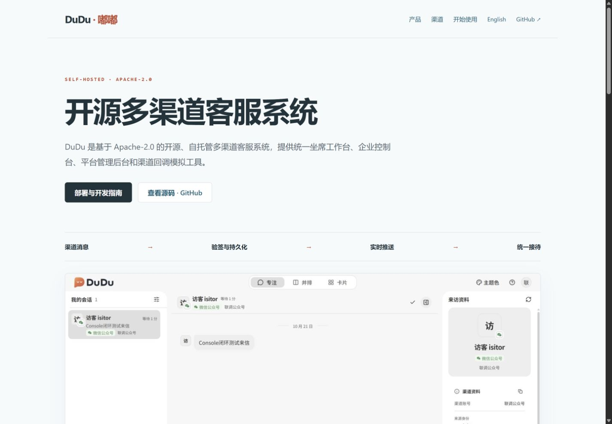

# DuDu 官网发布验收

本文记录同日早期发布版本。最新本地改版与验证见[产品导览改版](product-tour.md)，尚未发布的改动不计入本文上线结论。

日期：2026-10-21。源码位于仓库根 `website/`，维护与素材来源见[官网说明](../../../website/README.md)。

## 设计与内容

面向评估自托管多渠道客服系统的使用者与开发者。当前版本采用深海蓝、雾银和冰蓝，保留 DuDu 珊瑚色，通过立体消息交换台展示渠道汇聚过程；产品采用可切换的展示窗口。详细方案及取舍见[重设计记录](redesign.md)。中文为默认入口，英文为独立页面；截图保留测试数据与历史布局的来源说明。

## 已验证

- 中文和英文页面的相对资源、页内锚点及图片替代文本检查通过。
- 浏览器实际检查桌面首页和 390 px 宽的中英文布局，无页面横向溢出。
- 重设计另检查 1024 px 平板布局、示例消息流转、暂停时切换渠道、页签方向键切换、原图预览和 Escape 关闭；浏览器未记录脚本错误。
- 原生脚本通过 Node 语法检查，无新增依赖；系统减少动效的实现审查与验证范围见重设计记录。
- 公网中英文页面可访问，语言切换正常。
- GitHub Actions 首次发布成功：[发布记录](https://github.com/Buktal/dudu/actions/runs/39472352498)。
- README 双语版本和 GitHub About 已关联官网；Topics 按产品类别、部署方式及主要技术栈设置。

[手机页面验收截图](mobile.png)。截图展示静态帧，立体视差及消息光路请在官网体验。

此次仅修改官网及相关文档，未运行客服业务子项目测试。官网首屏为本地示例，不代表已部署可操作的客服演示环境；MockPulse 使用项目标识和功能介绍，未用历史原型冒充当前应用截图。
