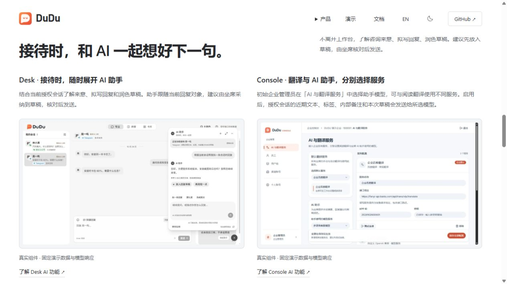

# AI 助手展示更新

日期：2026-10-26

## 内容与素材

- 中英文根 README 增加悬浮助手截图、使用方式、模型配置与资料使用说明
- 中英文官网首页新增 #assistant，展示 Desk 建议采纳与 Console 独立模型选择
- Desk、Console 双语产品页从 module-content.json 的 assistant 字段生成，避免手改产物被覆盖
- 原始 PNG 保留在 docs/design/dudu-desk/assistant，官网使用相应 WebP 副本，素材来源登记于 website/README.md
- 页面明确区分演示响应和实际模型调用，使用需企业配置受支持的模型服务

## 验证

- check-site.py 检查 28 个页面的本地资源、锚点、图片替代文本与 CSS 引用通过
- 浏览器核对中英文首页、明暗主题、390 × 844 视口及 Desk 产品页入口
- 首页图片可放大，Escape 关闭后返回图片链接
- 修改仅涉及官网展示与文档，未重跑客服业务子项目测试
- 本轮仅在本地验收，未发布到公网，保留既有 v0.2.0 功能 tag

[窄屏验收截图](assistant-showcase-narrow.png)
