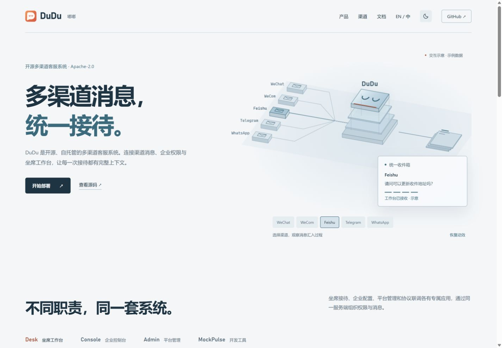

# 官网视觉重设计

2026-10-21。面向评估自托管客服系统的团队与开发者，通过产品特定的交互说明消息汇聚流程，建立对工程能力的直观认识

## 视觉方案

- 色彩：深海蓝 `#0b151e`、结构蓝 `#12232e`、雾银 `#e4edf1`、次级灰蓝 `#99adb9`、冰蓝 `#9acbd1`、品牌珊瑚 `#ed927a`
- 字体：英文展示使用本地 Bahnschrift，正文使用 Segoe UI / Microsoft YaHei；仅命令区使用 Cascadia Code / Consolas，不加载外部字体
- 布局：首屏左侧说明项目，右侧展示消息交换台；下方以四个产品页签共用一个展示区域，接续渠道和部署文档入口
- 核心标识：通过原生 Canvas 投影构造悬浮处理层、渠道输入与收件箱，消息光路串联这些结构；顶层沿用 DuDu 标识的 U 形眼睛

```text
项目定位与部署入口      渠道 → 悬浮处理层 → 收件箱
                       渠道选择 / 暂停

产品职责    Desk | Console | Admin | MockPulse
            当前产品界面 / 工具能力说明

渠道范围                渠道清单
运行指南                启动命令与开通流程
开源许可证              参与入口
```

## 取舍与调整

强调消息系统本身的空间结构与交互，避免使用与业务无关的粒子背景。进一步按用户反馈删除首屏统计条、板面点阵、十字定位、截图区装饰线、重复英文小标题和渠道表格边框。保留页签选中标识、产品截图边界及必要的信息分组。来源说明改为可展开内容

动效围绕一条消息完成：输入、处理层、出站光路及收件箱状态。处理层增加玻璃面光照与短暂的派发波纹；指针仅控制轻微视差。不存在实时流量、性能成绩或真实业务 API 调用的宣称

## 交互与验证

实测消息选择与完成状态、暂停时立即切换示例、页签方向键切换、截图放大及 Escape 关闭。检查中英文桌面和 390 px 手机布局，手机端移除重复的画布微型渠道标签，保留可操作的渠道按钮与收件箱内容。资源与锚点通过本地校验，两个 JavaScript 文件通过 Node 语法检查

系统减少动效由 `matchMedia` 监听并采用静态结果，经过实现审查；未在操作系统设置中切换该选项进行端到端验证。业务项目未改动，未执行其测试

## 窄屏修正与双主题

按用户截图反馈，将文字和 Canvas 从绝对定位改为独立网格列，保留 32 px 列间距；不超过 950 px 时采用上下布局，避免画布标签与正文发生重叠。实测 1100 px 双列、820 px 上下布局及 390 px 手机布局，无横向溢出

新增导航栏外观按钮。首次按系统外观初始化，在样式绘制前应用主题；手动选择后跨刷新与语言页面保留。明亮配色采用冷白、深蓝文字与青蓝线路，页面表面、收件箱、代码区和 Canvas 均同步切换；截图本身保留原始应用配色。存储不可用时仍支持当前页切换

实测双向切换、刷新记忆、中文到英文页面的主题继承，以及切换后的消息动效。脚本语法检查通过，浏览器未记录错误。系统外观变化的自动跟随路径经过实现审查，未修改操作系统外观进行端到端验证


